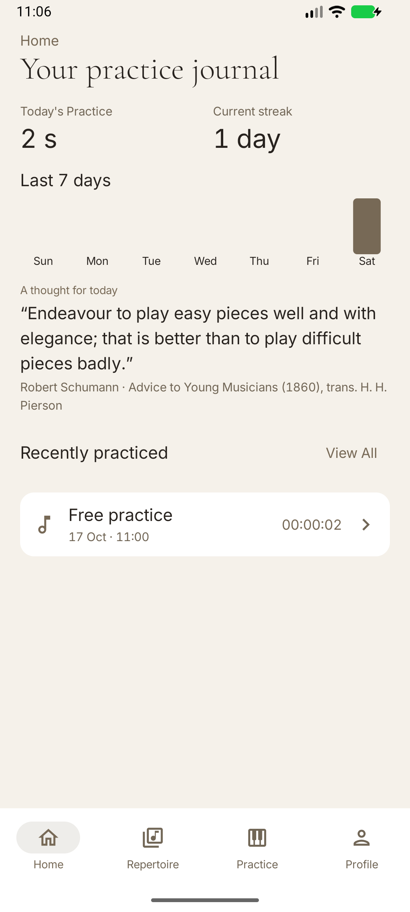

# Goldberg

A native Android piano practice journal built with Kotlin, Jetpack Compose, Material 3 and Room. Android 8.0+; English and Czech; light and dark themes. Your journal stays local.

**Goldberg [0.9.2](https://github.com/stokonn/Goldberg/releases/tag/v0.9.2)** — an editorial piano-practice journal with optional Google profile identity.

[Download](https://github.com/stokonn/Goldberg/releases) · [Official Wiki](https://github.com/stokonn/Goldberg/wiki) · [Issues](https://github.com/stokonn/Goldberg/issues) · [Development Project](https://github.com/users/stokonn/projects/2) (authorized collaborators)

- Durable manual and experimental Smart Practice, multi-piece sessions, notes and review.
- Local repertoire, catalogue information, paged history and per-piece accounting.
- Profile, earned badges and a five-badge showcase.
- Portable backups, restore, CSV exports and optional reminders.
- Classic Piano branding and Bach’s Secret.



Before updating, export a backup. Never uninstall to bypass a signing error. Google identity does not synchronize practice data. Google sign-in, display-name/avatar import, nickname preservation, restart, sign-out and switching passed owner-reported manual verification on a Galaxy A55. Codex performed no physical-phone testing. See [verification evidence](docs/VERIFICATION-0.9.2.md).

## Development

Read [AGENTS.md](AGENTS.md) for the canonical development and release policy, [the Developer Guide](docs/wiki/Developer-Guide.md) for architecture and AI-agent integrations, and [the 0.9.2 implementation checklist](docs/PLAN-0.9.2.md). Use the existing Gradle wrapper, JDK 17-compatible toolchain and Android SDK 36:

```sh
./gradlew clean assembleDebug testDebugUnitTest assembleDebugAndroidTest lintDebug --no-daemon --max-workers=1
```

Build artifacts are under `app/build/outputs/apk/`. Compilation is not device verification. Mandatory quality, data-compatibility, rendered-UI and signing checks must pass before the automatic release workflow. Use emulators only; never target the owner's physical phone. The GitHub quality workflow runs host checks; compatible release signing and emulator/owner acceptance remain separate gates. Local and remote CI results are recorded separately.

[Signing](docs/SIGNING.md) · [Backup](docs/BACKUP.md) · [Google configuration](docs/GOOGLE-IDENTITY-SETUP.md) · [Changelog](CHANGELOG.md) · [Licenses](docs/LICENSES.md)

created by stokonn with love <3
