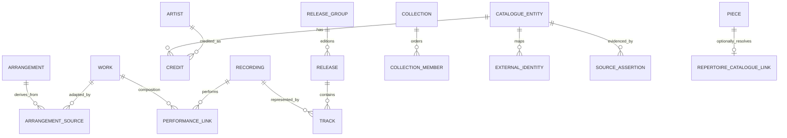

# Proposed unified catalogue and external identities

**Proposed logical contract, not Room entities, SQL or an implemented schema.** Decide details in Stage 2 before code/migration. The private local journal remains authoritative for personal data. A canonical catalogue may contain a curated cloud overlay plus locally resolved provider records; it is not required to be one complete centralized global database.

## Entity boundaries

| Concept | Proposed identity and fields | Relationships / caveats |
|---|---|---|
| CatalogueEntity | Opaque Goldberg UUID, kind, revision, status, original display title/name | Typed root for mapping/provenance; source IDs are not internal primary keys. Local unresolved nodes can later be mapped without replacing journal IDs. |
| Work | Original composition/song, title, language, composition-date precision, catalogue identifiers, optional key/instrumentation | Multiple role-bearing creator credits and genres. Movements are works with ordered parent/part relations. Medley relations may link multiple works; do not infer all “covers” are arrangements. |
| Arrangement | Distinct playable adaptation, title, instrumentation, arranger credits, version/difficulty provenance | Many-to-many arrangement-source-work relation (supports medleys); original work and adaptation remain separately identifiable. Unknown arrangement stays unknown. |
| Artist | Person/group/other explicit type, original/sort names, life/activity dates with precision | Multiple roles per work/recording/release: composer, lyricist, arranger, performer, conductor, ensemble, etc. Roles attach to relationships, not one global artist profession. |
| Album / ReleaseGroup | Conceptual album family, primary/secondary type, title, artist credits | Maps to MusicBrainz release-group. UI “Albums” initially groups these; owner decides treatment of singles/EPs. |
| Release | Particular issued edition, date precision, country, label/barcode/catalogue number | Belongs to a ReleaseGroup; ordered media/tracks, each track references a recording and has track-specific title/credit/position. Reissues are not duplicates to delete. |
| Recording | Particular recorded performance/mix, title, optional duration and ISRCs | Many artists and performed works/arrangements; one work can have many recordings, and one recording can perform multiple works. Metadata does not license audio. |
| Collection | Typed curated list, title/description, visibility, owner/provenance, revision | Ordered typed members with stable member IDs; duplicates may be meaningful. Avoid recursive membership/cycles initially. Search “Lists” maps here; do not imply support for private MusicBrainz collections. |
| Alias / Identifier | Value, normalized value, language/script/type, source/revision | Alias belongs to one entity; title variants/transliteration/misspelling never overwrite the original. Catalogue numbers use issuer/scheme/value. ISRC identifies recordings; barcode identifies releases; neither alone proves equivalence. |
| EntityRelation / Credit | Typed endpoints, role/relation, order, join phrase, source evidence | Preserve credited artist strings separately from resolved artist entities; unknown contributors remain explicit. |
| SourceAssertion | Subject/field/value, source record/revision/URL, retrievedAt, license, verification state | Multiple conflicting assertions retained; selected display value has a reason and provenance. No blanket “best source” overwrite. |
| EncyclopediaDocument | Entity/language/source/page+revision ID, content hash, text, attribution/license/change notice | Separate from CC0 facts. Link to revision/history; sanitized text, not arbitrary executable HTML. |
| MediaAsset | Source file/revision/hash, MIME/dimensions/size, author/credit/license/source URL, restrictions, transformations | Downloads allowed only after rights/policy gate; separate from journal avatar and external recording links. |

The diagram is abbreviated: CatalogueEntity is a typed parent of works/artists/arrangements/albums/releases/recordings/collections, and the repertoire sidecar may reference a work plus optional arrangement. Physical table/FK design is a Stage 2 deliverable, including how to enforce typed references without dangling polymorphic IDs.

## Mapping and merge policy

Proposed ExternalIdentity uniqueness: `(provider, providerEntityType, externalId)`. Store Goldberg entity ID, observed revision, mapping state/evidence, redirect target, reviewedAt and optional reviewer. Examples: `(openopus,work,"123")`, `(musicbrainz,work,MBID)`, `(musicbrainz,release-group,MBID)`, `(wikidata,item,QID)`. These are examples of key shape, not asserted mappings. Wikipedia pages use language/project + page ID and article revision; Commons files need file/revision/hash identity, not a Wikipedia image URL.

A provider redirect is an alias to resolve and audit, not permission to delete local records. Different entity types cannot be merged (work ≠ recording ≠ release). At most one current canonical target per provider key; preserve superseded assertions and reviewed merges. Mapping claims do not automatically inherit licenses from either side.

Matching order: an explicit existing reviewed cross-ID relationship; otherwise typed candidate matching using creator identities, catalogue number, dates/instrumentation and title aliases. Normalized title similarity, translated title, search ranking or a matching surname are only candidate signals. Conflicting dates, arrangement/edition ambiguity or multiple plausible people produce `needs_review`, never an automatic merge. Preserve unknown date precision; no January 1 fabrication. Reversible catalogue redirects do not rewrite session snapshots or manually entered strings.

Stage 2 fixture set must include same-name people, a group, alternate scripts/diacritics, standard jazz tunes, film/game adaptations, medleys, two piano arrangements of one song, a multi-movement classical work, live/studio recordings, remastered editions, redirects, missing IDs and conflicting source claims. Coverage measurements must include every approved genre and report missing coverage honestly. No fabricated genres/difficulty/encyclopedia content to fill gaps.

## Personal repertoire compatibility

Keep Piece.id, existing title/composer/notes/status/difficulty, legacy catalogue strings and recording workKey untouched. Propose a sidecar link keyed by Piece.id, with nullable workEntityId/arrangementEntityId and mapping provenance. Null means fully usable manual repertoire. Several personal pieces may link to the same work if they represent different arrangements or personal editions; do not enforce global work uniqueness here. Cloud moderation must not select or merge a user's pieces.

Seed local typed mappings for existing catalog_composers/catalog_works; retain numeric Open Opus IDs and all historical consumers during a transition. FavoriteComposer retains date/legacy key with optional sidecar artist identity. Preserve hardcoded badge identity semantics until explicit verified mappings exist. Existing SavedRecording links remain user data; optional Recording links supplement them without changing URLs/preferred status. Retain routes/deep links and URI-encode new opaque IDs; remove numeric assumptions only in a separately verified stage.

Draft JSON v1, session/part snapshots, session_piece_links and completion tokens keep their original payloads and timing. Do not recompute practice credit from catalogue or Recording.duration. No network request is required during migration, recovery or restore. Cache disposal may remove text/media but must retain sufficient link identity/title/attribution to open repertoire and history.

## Search and synchronization contracts

Use one typed search result envelope: kind/internal ID, original display name, credited creators, secondary disambiguation, provider identities, source/license summary, cache/offline status and partial errors. “All” groups/deduplicates only proven equivalent entities; Works contains compositions and clearly labeled arrangements; Artists includes people/groups; Albums groups release families and exposes editions; Lists contains supported public/curated collections. Exact arrangement presentation and album types remain decisions, not extra top-level tabs.

Proposed bounded SQL/search index uses normalized aliases/catalogue IDs with original strings retained; cursor pages carry stable tie-breakers and provider cursors. Maintain query-generation tokens so late provider responses cannot replace newer searches. Provider limits differ; local results arrive first, then independently labeled online results. A pending/failed source is not “no matching works.” Explicitly define search completeness and offline coverage; no claim to search all global music offline.

Curated cloud changes use schemaVersion, monotonic revision/cursor, tombstone/redirect records and signed or authenticated integrity metadata. Apply idempotently in a local transaction after validation; preserve prior usable revision on interruption. Backend approval updates the published overlay and audit trail atomically, never journal tables. A catalogue tombstone hides an untrusted listing while preserving personal references. Portable backup evolution and physical schema are gated in [STAGES.md](STAGES.md).

created by stokonn with love <3
