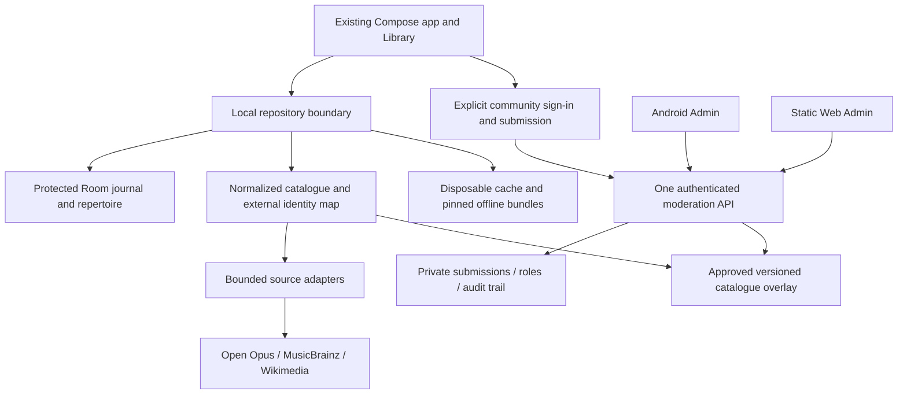

# Goldberg 0.11 — Stage 1 architecture and readiness

Status: **planning, not implemented**. Audit date: 2026-10-18. Audited source: `556970ab7407ec6986e3678657adbd2168516468` (post-release maintenance); production `v0.10.1` remains `b19b77b81e76feef6baf83e6c4bfa935e7c10bea`. Stage 1 changes documentation only on `planning/goldberg-0.11-stage-1`. No merge, release, production code/schema/build edit or cloud provisioning is authorized by this stage.

Evidence labels throughout: **Verified** means source inspected or a command executed; **Proposed** means a design for a subsequent stage; **Decision** means a choice not yet settled. Source-document verification does not establish live provider availability or account eligibility. External terms were checked on the audit date and must be rechecked before integration.

## Approved direction and boundaries

The owner approves the target architecture: a unified multi-genre catalogue (classical, jazz, blues, pop, rock, film/game and other music), Open Opus/MusicBrainz/Wikidata/Wikipedia/licensed Commons integrations, linked works/arrangements/artists/albums/recordings/collections, sourced encyclopedias, All/Works/Artists/Albums/Lists search, offline bundles and Smart Cache 2.0, Wi-Fi-first updates with explicit mobile permission, Google-authenticated moderated suggestions, Android and Web Admin sharing one secured backend, and a strict **0 CZK/month, no paid upgrades** limit. Preserve Goldberg 0.10.1 typography, themes, controls and customization.

Approval of that direction is not evidence these features exist. Stage 2 requires a separate execution instruction and resolution of its blocking decisions. Local practice/repertoire must never depend on a cloud account or service availability. Journal cloud synchronization, streaming media, sheet-music redistribution and automatic AI-generated encyclopedias are not implied by this scope.

## Reading order

1. [Current source audit and migration risks](CURRENT-STATE.md).
2. [Proposed catalogue model and identity mapping](DATA-MODEL.md).
3. [Source/license matrix and API constraints](SOURCES-LICENSES.md).
4. [Offline/cache/bundle design](OFFLINE-CACHE.md).
5. [Community authorization, moderation and both Admin clients](COMMUNITY-ADMIN.md).
6. [Managed free-tier comparison and operating limits](CLOUD.md).
7. [Stages, acceptance criteria and decision register](STAGES.md).
8. [Executed checks, limitations and workflow evidence](VERIFICATION.md).

The [earlier roadmap](../../ROADMAP-0.11-DATABASE.md) remains historical planning input. Its data-preservation, provenance, bounded-search and measurement requirements remain binding. This package expands source/genre/community scope under the owner's newer instructions; it does not silently implement earlier proposals.

## Proposed architecture

This is a logical diagram, not new deployable infrastructure. Reuse OpusApplication ownership, repositories, Room transactions, PracticeCoordinator, Compose Navigation and theme tokens. Introduce interfaces at catalogue/provider/cache/auth boundaries rather than a second journal or timer. A provider adapter returns provenance-bearing data and partial errors; it never writes journal rows. The optional moderation service stores suggestions and curated overlays, not personal practice data or a worldwide mirror.

**Recommendation:** evaluate a bounded Supabase Free moderation service first, with managed Auth, PostgreSQL authorization and transactional review. Keep media/provider reads direct and optional. A static free-hosted Web Admin can use the same API. Cloudflare Workers/D1 is viable as an alternative if free CPU/auth and abuse-control gates pass, but it requires more custom security/session work. This is a recommendation, not a provider selection or provisioning approval. See [trade-offs and shutdown policy](CLOUD.md).

## Stage 1 checklist

- [x] Read canonical policy and permanent maintenance record; preserve unrelated work.
- [x] Inspect actual build, schemas, source flows, tests and GitHub resources.
- [x] Verify primary provider documentation and record unavailable/uncertain evidence.
- [x] Reconcile the previous roadmap without deleting it.
- [x] Specify conceptual model, migration safeguards, offline policy and security boundary.
- [x] Compare zero-cost managed options, with fail-closed budget behavior.
- [x] Define independent stages and acceptance gates; run baseline/document checks.
- [ ] Owner resolves applicable decisions and separately instructs Stage 2. **Do not start automatically.**

created by stokonn with love <3
