# Goldberg

Goldberg is a native Android music journal for classical pianists, created by stokonn. It combines a personal repertoire, manual and experimental Smart Practice timing, multi-piece session review, statistics and earned badges.

The current release is [Goldberg 0.10.1](https://github.com/stokonn/Goldberg/releases/tag/v0.10.1). It refines the editorial interface, local composer favorites, Favorite Artist selection and historical session editing while preserving the existing practice journal. Google identity is optional profile identity, not cloud practice synchronization.

Start with [Getting Started](Getting-Started), then read the [User Guide](User-Guide). See [Settings & Customization](Settings-and-Customization), [FAQ & Troubleshooting](FAQ-and-Troubleshooting), [Developer Guide](Developer-Guide), [Changelog & Roadmap](Changelog-and-Roadmap) and [Credits & Licenses](Credits-and-Licenses).

Screenshots are added only after actual emulator capture and inspection. No illustrative mockup is presented as a verified app screenshot. Codex performs no physical-phone testing; owner-reported results are attributed separately below.

created by stokonn with love <3

## Goldberg 0.10.1 emulator captures

These inspected captures use a generic local identity. No private reference images or new third-party portrait files are published here.

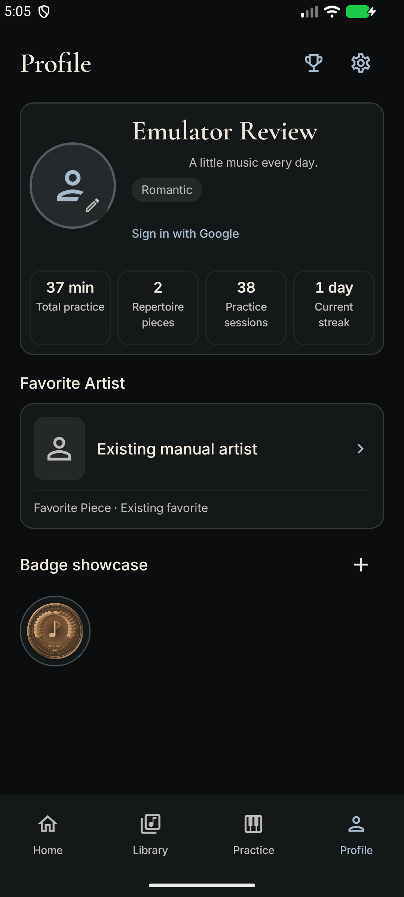

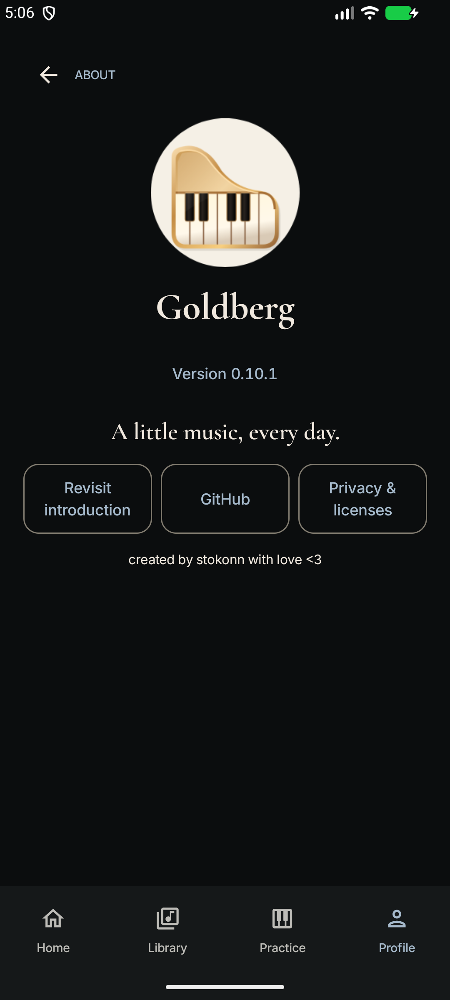

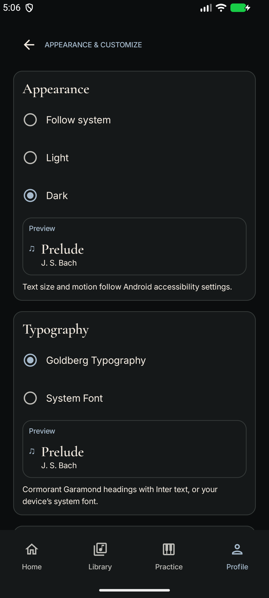

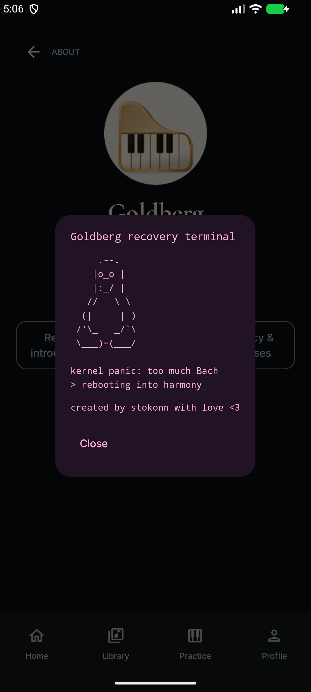

## Historical development screenshots

These are actual emulator captures of the 0.10 verification build, using controlled test data. They are not physical-device verification. The Google scenarios reported below were manually tested by the owner.

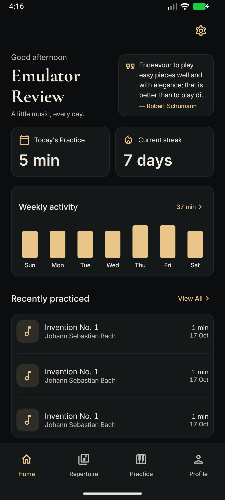

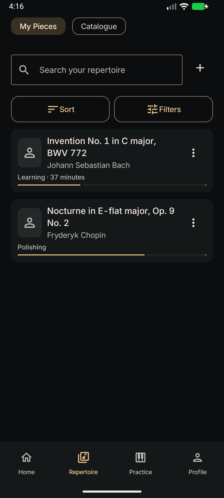

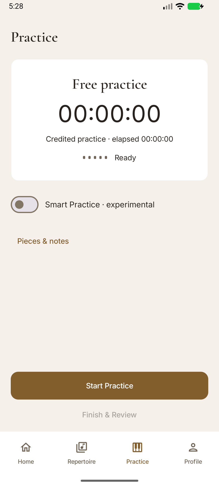

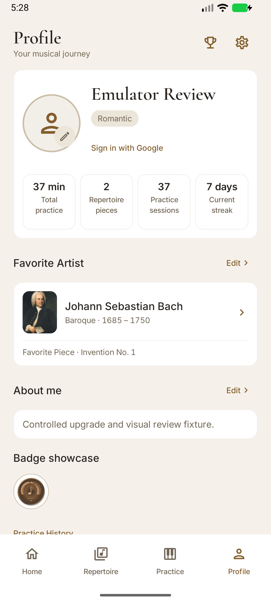

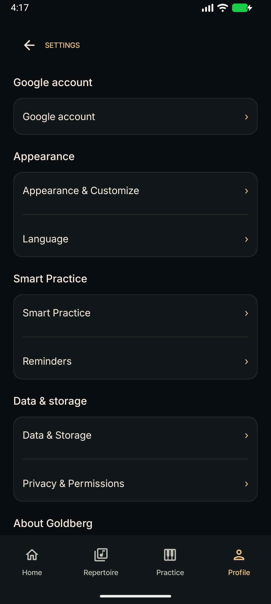

The Bach's Secret keyboard and Tux terminal captures below are retained from the verified 0.9.2 emulator build; those screens were not recaptured for 0.10.

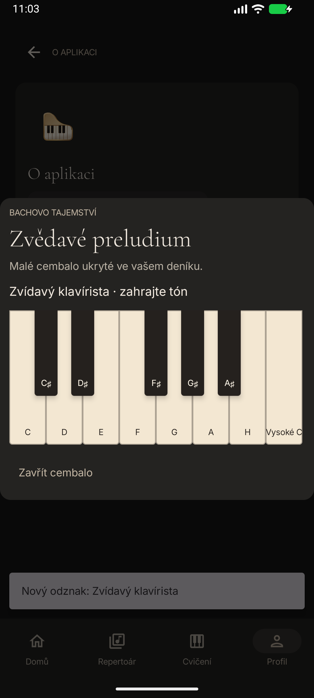

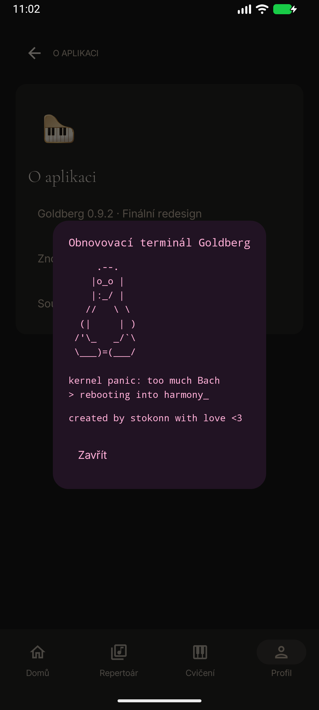

[Verification status](Verification) separates automated/emulator checks from the owner’s manual report. The six 0.10 Google scenarios are recorded as PASS — owner-reported manual verification.
