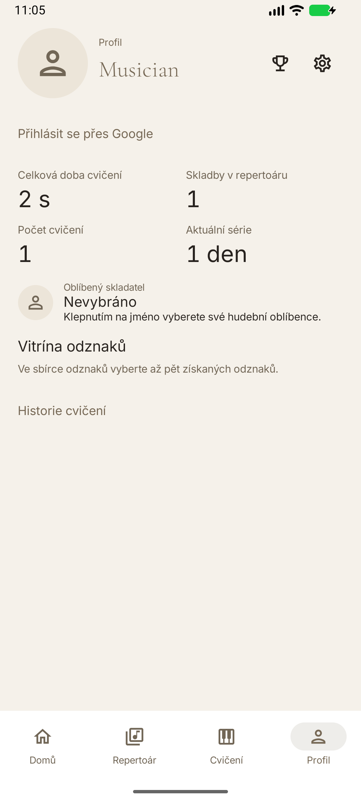

# Goldberg

Goldberg is a native Android music journal for classical pianists, created by stokonn. It combines a personal repertoire, manual and experimental Smart Practice timing, multi-piece session review, statistics and earned badges.

The current release is [Goldberg 0.9.2](https://github.com/stokonn/Goldberg/releases/tag/v0.9.2). It combines the editorial design, daily activity/quotations and optional local Google identity with the existing practice journal. Google identity is not cloud practice synchronization.

Start with [Getting Started](Getting-Started), then read the [User Guide](User-Guide). See [Settings & Customization](Settings-and-Customization), [FAQ & Troubleshooting](FAQ-and-Troubleshooting), [Developer Guide](Developer-Guide), [Changelog & Roadmap](Changelog-and-Roadmap) and [Credits & Licenses](Credits-and-Licenses).

Screenshots are added only after actual emulator capture and inspection. No illustrative mockup is presented as a verified app screenshot. Codex performs no physical-phone testing; owner-reported results are attributed separately below.

created by stokonn with love <3

## Development screenshots

These are actual emulator captures of the 0.9.2 verification build, using controlled test data. They are not physical-device verification or evidence of completed Google sign-in.

[Verification status](Verification) separates automated/emulator checks from the owner’s reported successful Google authentication. The six Google scenarios are recorded as PASS — owner-reported manual verification.
